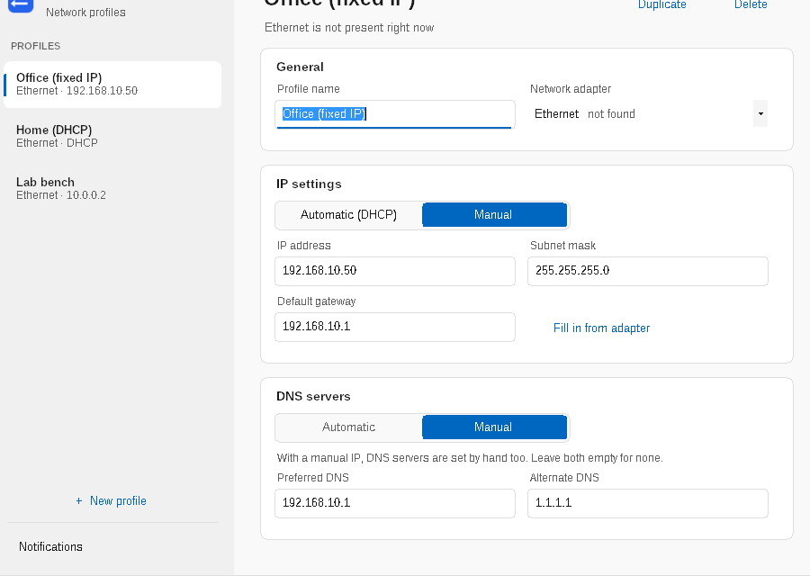
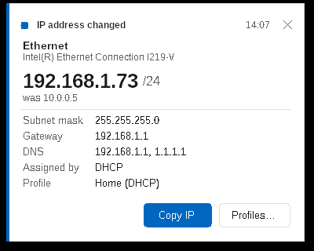

# NetSwitch

A small Windows tray app that switches a network adapter between saved profiles with one click (for example a fixed IP and DHCP) and pops up a notification when the IP address of a watched adapter changes.





## Which exe to use

| File | Size | Needs |
|---|---|---|
| `NetSwitch.exe` (framework-dependent build) | ~250 KB | [.NET 8 Desktop Runtime](https://dotnet.microsoft.com/download/dotnet/8.0) (x64). Windows asks to install it on first run if it is missing. |
| `NetSwitch.exe` (self-contained build) | ~70 MB | Nothing. Runs on any 64-bit Windows 10/11. |

Put the exe anywhere you like (for example `C:\Tools\NetSwitch\`) and run it.

## Using it

- **Click the tray icon** (left or right) to open the menu.
  - The top lines show each adapter's current IP and whether it is DHCP or static.
  - Click a **profile** to apply it. The profile that matches the adapter's current state has a check mark.
- **Edit profiles…** opens a window where you add, remove and reorder profiles:
  - Name, adapter, DHCP or static IP / mask / gateway / two DNS servers.
  - The mask accepts `255.255.255.0` or `24`; the IP also accepts `192.168.1.50/24`.
  - **Copy current settings** fills the fields from the adapter as it is right now.
  - The bottom list picks which adapters trigger a pop-up when their IP changes.
- **Notify on IP change** turns those pop-ups on or off.
- **Start with Windows (no UAC prompts)** registers a logon task that starts NetSwitch with admin rights. With it on, switching never shows a UAC prompt. With it off, Windows asks for permission each time you switch, because changing IP settings needs admin rights.

On first run NetSwitch creates an "Automatic (DHCP)" profile for your main adapter and opens the editor.

## Where settings live

`%APPDATA%\NetSwitch\config.json` – plain JSON, safe to edit by hand or copy to another PC:

```json
{
  "Profiles": [
    { "Name": "Office", "Adapter": "Ethernet", "Dhcp": false, "Ip": "192.168.1.50", "Mask": "255.255.255.0", "Gateway": "192.168.1.1", "Dns": ["192.168.1.1", "8.8.8.8"] },
    { "Name": "DHCP", "Adapter": "Ethernet", "Dhcp": true }
  ],
  "WatchAdapters": ["Ethernet", "Wi-Fi"],
  "NotifyOnIpChange": true
}
```

## How it works

- Switching runs `netsh interface ipv4 set address / set dnsservers` for the adapter. When NetSwitch is not elevated it re-launches itself through UAC with `--apply "<profile>"`, does only that, and exits.
- IP watching uses Windows network change events (no polling), waits 2 seconds for things to settle, then compares the watched adapters' IPv4 addresses with the previous state.
- Pop-ups are standard Windows notifications, so Focus Assist / Do Not Disturb can hide them.

## Building

Needs the .NET 8 SDK (Windows, Linux or macOS). On Windows: `winget install Microsoft.DotNet.SDK.8`, then:

```
git clone https://github.com/JetLaggedJackal/netswitch
cd netswitch\src
dotnet publish -c Release --self-contained false -o ..\dist\small
dotnet publish -c Release --self-contained true -p:EnableCompressionInSingleFile=true -o ..\dist\standalone
```

To uninstall: untick "Start with Windows", exit from the tray menu, delete the exe and `%APPDATA%\NetSwitch`.

`NetSwitch.exe --preview editor|notify|popup|applied|error|menu` shows one piece of the UI on its own (for design checks).
