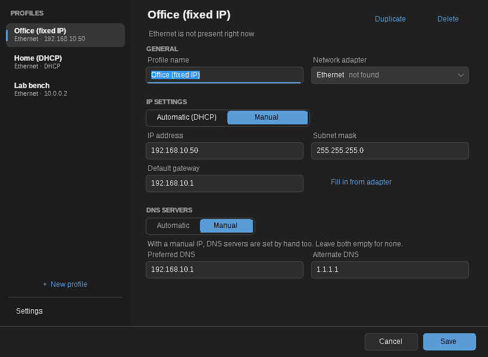

# NetSwitch

A small Windows tray app that switches a network adapter between saved profiles with one click (for example a fixed IP and DHCP) and pops up a notification when the IP address of a watched adapter changes.



 

## Which exe to use

| File | Size | Needs |
|---|---|---|
| `NetSwitch.exe` (framework-dependent build) | ~250 KB | [.NET 8 Desktop Runtime](https://dotnet.microsoft.com/download/dotnet/8.0) (x64). Windows asks to install it on first run if it is missing. |
| `NetSwitch.exe` (self-contained build) | ~70 MB | Nothing. Runs on any 64-bit Windows 10/11. |

Put the exe anywhere you like (for example `C:\Tools\NetSwitch\`) and run it.

## Using it

- **Left-click the tray icon:** your profiles. Click one to switch; the active one has a dot.
- **Right-click the tray icon:** every adapter with its IP, DHCP/static, gateway and matching profile. Click an adapter to copy its IP. Settings and Exit are here too.
- **Settings…** opens the window where you:
  - add, duplicate and delete profiles: name, adapter, IP Automatic/Manual, DNS Automatic/Manual (DHCP with your own DNS works);
  - turn on **Start with Windows** (starts at sign-in with admin rights, so switching never shows a UAC prompt);
  - choose pop-up behaviour, and per adapter whether it shows in the right-click list and whether it pops up when its IP changes.
- When a watched adapter's IP changes, a pop-up shows the old and new IP, mask, gateway, DNS, DHCP server and lease, Wi-Fi name, matching profile, link speed and MAC.

## Where settings live

`%APPDATA%\NetSwitch\config.json` – plain JSON, safe to edit by hand or copy to another PC:

```json
{
  "Profiles": [
    { "Name": "Office", "Adapter": "Ethernet", "Dhcp": false, "Ip": "192.168.1.50", "Mask": "255.255.255.0", "Gateway": "192.168.1.1", "Dns": ["192.168.1.1", "8.8.8.8"] },
    { "Name": "DHCP", "Adapter": "Ethernet", "Dhcp": true }
  ],
  "WatchAdapters": ["Ethernet", "Wi-Fi"],
  "NotifyOnIpChange": true
}
```

## How it works

- Switching runs `netsh interface ipv4 set address / set dnsservers` for the adapter. When NetSwitch is not elevated it re-launches itself through UAC with `--apply "<profile>"`, does only that, and exits.
- IP watching uses Windows network change events (no polling), waits 2 seconds for things to settle, then compares the watched adapters' IPv4 addresses with the previous state.
- Pop-ups are standard Windows notifications, so Focus Assist / Do Not Disturb can hide them.

## Building

Needs the .NET 8 SDK (Windows, Linux or macOS). On Windows: `winget install Microsoft.DotNet.SDK.8`, then:

```
git clone https://github.com/JetLaggedJackal/netswitch
cd netswitch\src
dotnet publish -c Release --self-contained false -o ..\dist\small
dotnet publish -c Release --self-contained true -p:EnableCompressionInSingleFile=true -o ..\dist\standalone
```

To uninstall: untick "Start with Windows", exit from the tray menu, delete the exe and `%APPDATA%\NetSwitch`.

`NetSwitch.exe --preview editor|notify|popup|applied|error|menu` shows one piece of the UI on its own (for design checks).
